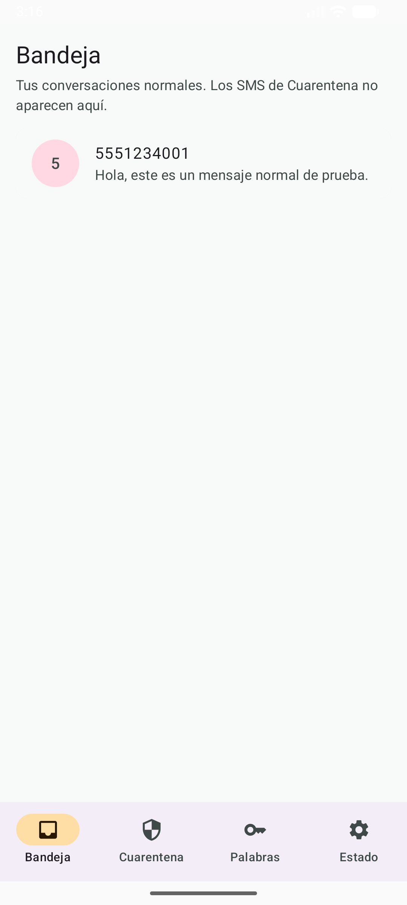
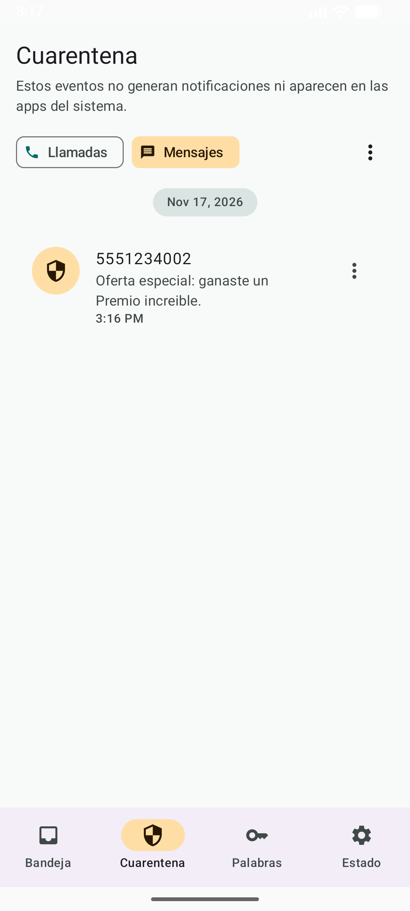
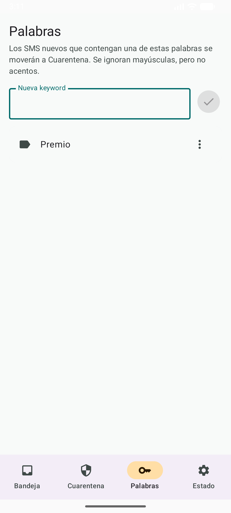
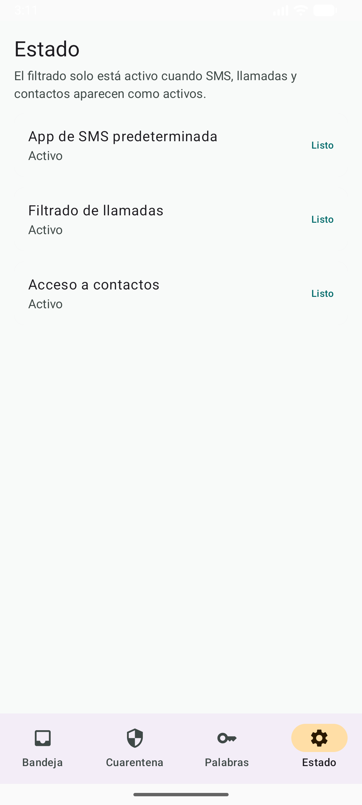
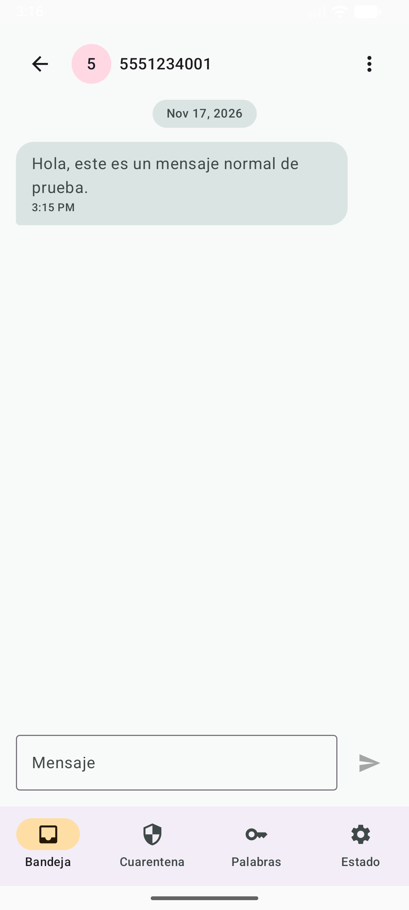
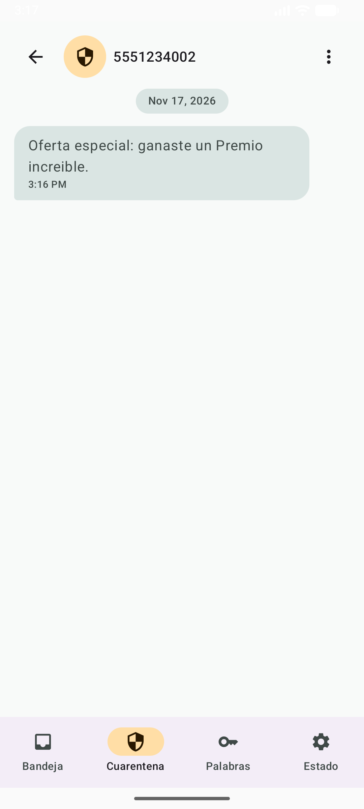

# Spam Blocker

The idea is simple: **filter without losing control**. No opaque blacklists or irreversible decisions. You choose the rules, review what was filtered out, and decide whether to restore it or delete it.

  
  

## See it in action

Spam Blocker keeps the experience focused: normal conversations stay in the inbox, while suspicious messages and calls are isolated in quarantine.

<table>
  <tr>
    <td align="center"> <b>Inbox</b></td>
    <td align="center"> <b>Quarantine</b></td>
  </tr>
  <tr>
    <td align="center"> <b>Keyword rules</b></td>
    <td align="center"> <b>Protection status</b></td>
  </tr>
  <tr>
    <td align="center"> <b>Inbox conversation</b></td>
    <td align="center"> <b>Quarantined conversation</b></td>
  </tr>
</table>

## What You Can Do

- **Quarantine for Suspicious Items**: Separates blocked calls and text messages that match your keywords, keeping them separate from your main inbox.
- **Rules You Can Understand**: Add text message filtering keywords in seconds.
- **Call Management**: Review and delete blocked calls right from the quarantine section.

## Privacy by Design

- Data is stored locally on the device.
- The app does not require an Internet connection.
- You choose the filter words; you don't rely on a remote database to decide what to filter.

Spam Blocker requires sensitive permissions because Android provides special protection for SMS messages and calls. You can check the status of each permission within the app itself and grant them explicitly.
